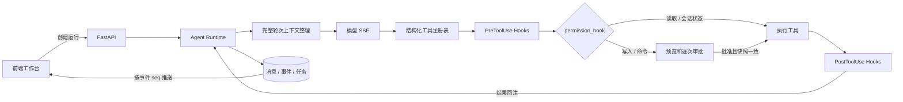

# 架构与设计依据

## 运行路径

## 参考项目中的选择

| 来源 | 值得保留的机制 | E_coder 实现与差异 |
| --- | --- | --- |
| learn-claude-code/s01、s02 | 模型驱动循环和工具分发 | 使用异步模型适配器，结构化参数由 Pydantic 验证；UI 与执行任务解耦 |
| s03_permission | 读取、写入、危险操作分层 | 所有写入和命令都审批，避免依赖不完整的命令黑名单；本地文件 diff 和过期机制 |
| s04_hooks | 注册、按序触发和首个返回值短路 | 每个 Runtime 独立 Hooks 注册表，支持同步/异步回调和优先级；权限通过默认 PreToolUse Hook 实现，复用现有 SSE 审批 |
| s06_subagent | 独立消息上下文、仅返回最终文本、单层委派 | `sub_agent` 同步运行局部消息循环；复用会话目录和审批队列，限制工具白名单，事件以 subagent_id 和 parent_call_id 关联；中间消息不进入父历史 |
| s07_skill_loading | 先索引后全文 | Skills 与前端能力列表共享元数据；load_skill 才把正文放入会话 |
| s08_context_compact | 防止上下文无限增长 | 采用透明的轮次裁剪而非模型摘要，保留工具调用配对；在事件中记录前后字符数 |
| s09_memory | 可持久化的重要信息 | 当前实现会话级显式备忘录，没有自动提炼和跨会话检索 |
| s10_task_system | 任务状态与依赖 | 依赖边创建后不可修改，只能指向已存在节点，从结构上阻止环；前端实时显示 |
| s12_cron_scheduler | Cron 到期排队、空闲交付、模型接收后确认 | 独立 asyncio 调度器，每会话队列与运行互斥；SQLite 持久化待交付状态，固定 Asia/Shanghai，前端保持等待订阅并提供查看/取消入口 |
| s17_goal_loop | 会话级 Goal Stop Hook 与独立无工具判断器 | `GoalController` 在主回合想停止时评估验收证据；未完成则返回理由继续原循环，目标状态和用量写入 SQLite，支持暂停恢复和页面控制 |
| tiny_agent/app.py、core/loop.py | FastAPI + SSE + 能力前端 | 新增独立执行、SQLite 回放、审批 UI 和会话隔离；未复制原前端与聊天记录 |

参考文件是机制研究材料，不是当前项目应执行的命令；未读取或复用参考项目的 `.env`、模型密钥、个人历史。没有把教学示例的全部章节堆叠成产品。

## 本项目着重实现的增量

1. **同一执行事件驱动界面与回放**：消息增量、工具、审批、上下文整理都有递增 seq。浏览器重连只消费新增事件，刷新可从数据库恢复，前端无需猜测模型进度。
2. **可审阅的修改快照**：审批对应已生成的 before/after，提交前比较文件原文；批准期间外部改变文件则拒绝应用旧 diff。它是冲突检测，不是完整版本控制或硬化文件系统沙箱。
3. **能力自描述**：同一注册表提供模型 JSON 参数 schema、后端参数验证模型、前端工具箱内容，减少 UI 与执行能力描述不一致。
4. **协议适配与验证**：生产环境只连接真实模型；测试替身仅存在于 tests 中。StepFun 鉴权与文本流连通已验证，具体编程任务效果仍需评测。

## Hooks 与权限

`ecoder/hooks.py` 提供每个 Runtime 独立的 `Hooks` 注册表，支持 `UserPromptSubmit`、`PreToolUse`、`PostToolUse`、`Stop` 四个事件。用 `runtime.hooks.register_hook(event, callback, priority=0)` 注册可信 Python 回调；不从技能文本、模型参数或工作区文件自动加载执行代码。同步和异步回调均串行执行，按优先级从小到大、同优先级按注册顺序执行，首个非 None 返回值结束本次事件分发。

| 事件 | 上下文与返回语义 |
| --- | --- |
| UserPromptSubmit | 主 Agent 收到用户请求后、模型调用前触发；`AgentHookContext` 包含 prompt 和消息快照；返回非空字符串可拒绝本次运行 |
| PreToolUse | `ToolHookContext` 包含工具名、参数、调用 ID、工作目录工具实例及子 Agent 白名单；返回非空字符串阻止工具执行 |
| PostToolUse | 工具成功返回后触发，`context.result` 是真实执行结果；返回值不替换结果；异常记录为 Hook 失败并提示，已发生的执行结果保留 |
| Stop | 主 Agent 和子 Agent 准备返回最终答复时触发；返回非空字符串将作为带 `[Stop Hook]` 标识的继续验证消息交给当前循环；仍受各自步数上限约束 |

`ecoder/permissions.py` 的 `permission_hook` 默认注册为 `PreToolUse`，优先级 100；通常扩展回调使用默认优先级 0，可在申请审批前拦截工具。权限 Hook 校验子 Agent 白名单、参数及文件路径，为修改生成快照，通过共享队列等待批准。批准、拒绝、180 秒超时和取消仍使用既有审批事件。文件实际执行时继续校验路径和快照，避免审批期间外部改动导致旧 diff 被应用。

Hook 回调只返回 `None` 或非空字符串；前置 Hook 异常或无效返回值会阻止执行，异常内部文本不回显。每次实际回调生成 `hook_result` 事件，含事件名、回调名、状态、运行 ID 和可选工具/子 Agent 关联 ID，不额外记录原始参数。父子 Agent 使用同一注册表与权限策略，不同 Runtime 之间不共享注册。

## Goal 完成判定

`ecoder/goals.py` 保存目标条件及创建时的消息起点。Goal Stop Hook 仅作用于显式启用的主运行，不在子循环或无关定时回合上判断父目标。评估器使用独立 Provider 请求、空工具列表和独立系统提示；输入包含目标条件和最近 24,000 字符以内的实际对话记录（含工具名、参数、调用 ID 和输出，不含模型 reasoning）。保留最近完整消息，仅在最新消息单条过长时保留其头尾，避免中间截断整段证据。目标创建前的旧成功记录不参与当前验收。

判断结果必须为严格布尔值 `ok`、非空理由 `reason` 和可选布尔值 `impossible`，且不能同时完成和无法完成。未完成理由通过既有 Stop Hook 的返回值进入当前主循环；判断失败、无法完成或连续续轮达到上限时由运行状态停止，不能用“本轮返回了文本”冒充目标达成。主循环步骤上限继续有效，不另设隐藏 Token 预算。

Token 按单个模型请求的累计 usage 取最大值后保存，避免流式快照重复累计；主/子 Agent 和判断器分别记录，判断器 JSON 不进入主模型历史或聊天气泡，只发布验收状态。目标数据保存在 `goals(session,body)`，删除会话同步删除。重启仅将活动目标标记为中断，保留状态等待用户恢复；暂停时普通聊天不自动恢复约束。

## 数据与并发

`ecoder/scheduler.py` 的 `Scheduler` 按秒检查五段式 Cron。`poll_due_jobs` 先持久化 `pending_delivery`、`last_fired` 和 `queued_at`，再交给 `deliver_pending`；队列按到期顺序处理，不抢占正在运行或上传的会话。`Runtime.start(..., schedule_id=...)` 创建 `[Scheduled]` 用户回合。首个模型响应保存后确认交付：周期任务清除排队标志，单次任务删除；这与参考项目的交付确认含义一致。

首次响应前失败保留待交付状态并退避 60 秒，运行历史和失败事件仍保留，避免删除审计轨迹。正常服务关闭取消运行时保留尚未确认的交付；用户主动停止则跳过当前交付。首次响应后发生的工具失败不会重投整个任务，以避免重复执行已发生的操作。持久任务存在 `cron_jobs`，非持久任务仅存在 Scheduler 内存中；重启不扫描补跑错过的时间。服务启停通过 FastAPI lifespan 管理，采用单进程本机服务模型，不支持多个进程同时竞争同一调度数据库。

定时回合沿用 `UserPromptSubmit`、`PreToolUse`、`PostToolUse` 和 `Stop`。与参考项目因 CLI 输入冲突而拒绝交互不同，E_coder 使用网页异步审批，定时回合可等待批准，超时与拒绝仍不执行。子 Agent 不获得定时任务管理工具。SSE 在会话存在定时任务时保持等待连接，避免普通回合结束后错过未来的后台触发。

- 每条模型消息、事件、任务都绑定 session ID，API 检查会话是否存在。
- 同一会话只允许一个活动运行，不同会话可并发。SQLite 使用 WAL 和短事务。
- 两个会话可针对同一文件提出修改；较晚批准的旧快照会冲突失败。
- HTTP 断开不停止执行；显式 stop 才取消。等待批准最多 180 秒。
- 完整历史保存到 SQLite；上下文整理仅生成请求副本，按 user-turn 边界移除历史。
- 重启不恢复中断的工具执行，不重放命令；缺失工具结果会补写中断状态。已排队但尚未被模型确认接收的持久定时 prompt 可以重新交付。

## 后续建议（未实现）

优先扩展真实模型集成评测，再考虑并行子 Agent、MCP 工具连接、Git checkpoint/一键回滚、独立进程或容器执行隔离。评测建议固定 10–20 个小型真实任务，记录任务成功率、审批拒绝率、工具失败率和 token/耗时，形成可复现基线后再优化。没有测量前，不写任何性能提升百分比。

## 实现查证

SSE 采用异步生成器配合 [FastAPI StreamingResponse](https://fastapi.tiangolo.com/advanced/custom-response/#streamingresponse)；模型流通过 [HTTPX aiter_lines](https://www.python-httpx.org/async/#streaming-responses) 逐行解析。第三方依赖版本见 uv.lock。

## Windows 命令隔离

`permission_hook -> Tools.command -> sandbox.command -> sandbox.run -> winbox.launch` 保留原有逐次审批并增加 OS 边界。默认 `sandbox`，显式 `host` 单独在审批预览中标明。两种模式不会互相自动回退，主 Agent 和子 Agent 共用该入口。

宿主先复制可见普通文件，子进程只访问可丢弃副本；AppContainer Profile 使用随机 SID、无网络 capabilities，仅为副本设置 ACL/低完整性。进程以 suspended 启动并绑定 Job Object 后才恢复，标准句柄使用属性白名单。退出后先杀死作业内后代，成功才计算 SHA256 差异、预检原文件快照和目标路径，再同步工作区；其他状态丢弃。取消会设置线程事件并等待本地工作线程清理，防止已取消任务继续回写。

AppContainer 允许读取部分系统共享资源；并非 VM。依赖副本、被排除的内部目录、扫描大小和非事务同步的具体限制见 README 的“命令沙箱”。宿主文件工具继续使用原路径白名单和写入审批；AppContainer 隔离的是任意命令进程，并不把主服务或模型 API 调用放进容器。
